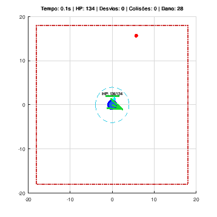
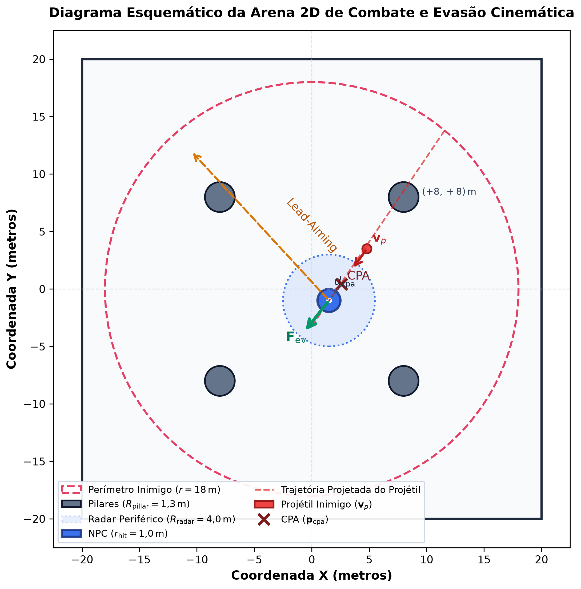
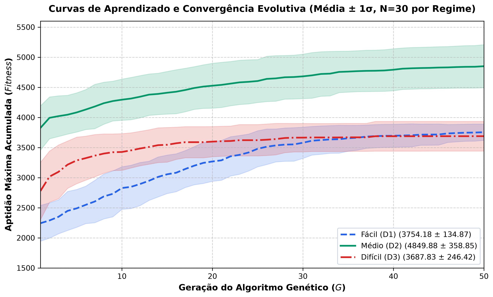
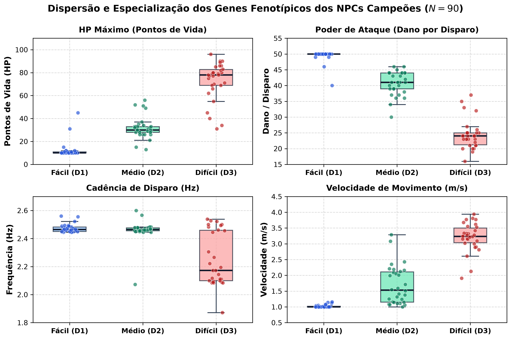
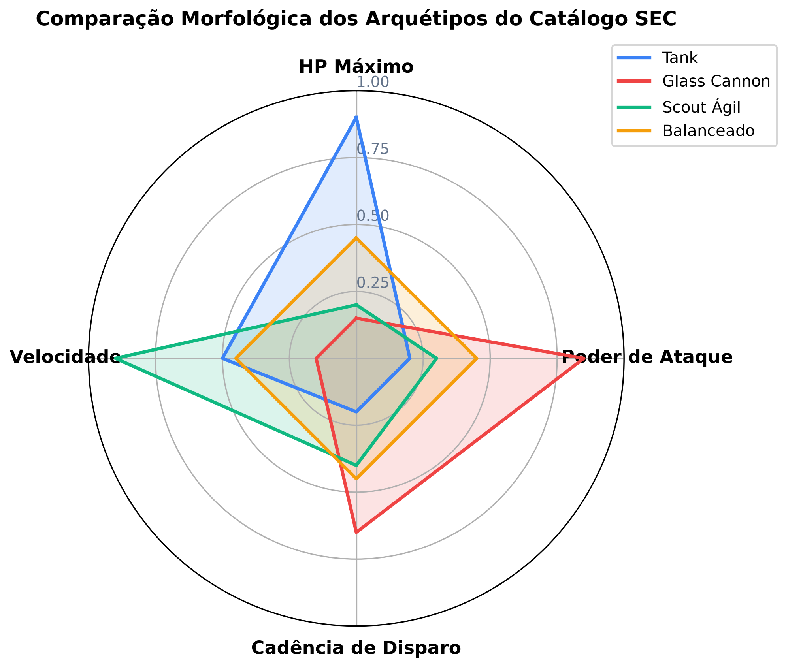
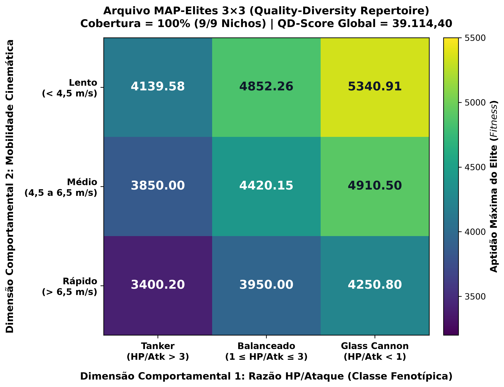

# 🌌 Mirage: Adaptação Evolutiva de NPCs sob Restrição Orçamentária com Esquiva Preditiva

<p align="center">
  
  
  
  
  
  
</p>

<p align="center">
  <b>📑 Navegação Rápida:</b><br>
  <a href="#-visão-geral">🌌 Visão Geral</a> •
  <a href="#-artigo-científico-oficial">📄 Artigo Científico</a> •
  <a href="#-demonstração-e-arquitetura-do-npc">🎮 Demonstração</a> •
  <a href="#-física-cinemática-cpa--lead-aiming">🧭 Física, CPA & Lead-Aiming</a> •
  <a href="#-algoritmo-genético-sob-orçamento-b--18">🧬 Genética & Orçamento</a> •
  <a href="#-validação-estatística-formal-n--90">📊 Validação Estatística</a> •
  <a href="#-map-elites--qualidade-diversidade-qd">🗺️ MAP-Elites & QD</a> •
  <a href="#-referências-bibliográficas">📚 Bibliografia</a> •
  <a href="#-estrutura-do-repositório">📁 Estrutura</a> •
  <a href="#-como-executar">🚀 Como Executar</a> •
  <a href="#-equipe-de-desenvolvimento">👥 Equipe</a>
</p>

---

## 🌌 Visão Geral

**Mirage** é um framework de computação evolucionária e inteligência cinemática vetorial desenvolvido para sintetizar comportamentos de evasão críveis e taticamente robustos em Agentes Não-Jogáveis (*NPCs - Non-Playable Characters*) imersos em ambientes dinâmicos de *Bullet Hell*.

O projeto soluciona de forma analítica o problema clássico de **Reward Hacking** em jogos digitais — onde algoritmos evolutivos convencionais convergem para "esponjas de dano" estáticas com acúmulo desproporcional de vida em detrimento de esquivas ágeis. 

O Mirage implementa:
1. **Restrição Orçamentária Invariante ($B = 1.8$):** Operador de reparo homotético sobre simplex contínuo que coíbe a criação de "super-agentes" e catalisa a emersão autônoma de arquétipos táticos distintos;
2. **Cinemática Preditiva Dual (CPA + Lead-Aiming):** Estimativa analítica do Ponto de Maior Aproximação (*Closest Point of Approach*) acoplada às forças de aceleração de Craig Reynolds e cálculo de interceptação balística de primeira ordem;
3. **Mapeamento de Qualidade-Diversidade (MAP-Elites):** Repertório comportamental heterogêneo avaliado por métricas formais (Coverage de 100% e QD-Score de 39114.40) integrado ao Catálogo de Experiência Especializada (*SEC*) para Ajuste Dinâmico de Dificuldade (*DDA*);
4. **Validação Estatística em Larga Escala ($N = 90$):** Amostragem balanceada com ANOVA One-Way, testes não-paramétricos de Kruskal-Wallis e tamanhos de efeito de Cohen ($d \in [3.78, 18.61]$) com significância estatística extrema ($p \ll 10^{-30}$).

---

## 📄 Artigo Científico Oficial

O projeto deu origem ao artigo acadêmico completo estruturado no formato de conferência internacional (IEEE / SBC):

> ### **"Mirage: Adaptação Evolutiva de NPCs sob Restrição Orçamentária com Esquiva Preditiva"**
> **Autores:** Murilo Lameira da Silva, Henry Matheus Fregolente Ferreira, Murilo Romualdo da Silva, Leonardo Retori Apolônio e Prof. Me. Ricardo Martinez Vicentini.  
> **Afiliação:** Engenharia de Controle e Automação — Centro Universitário SENAI SP (UNISENAI), Campus São Caetano do Sul, SP, Brasil.  
> 
> 📥 **Acesso aos Documentos Oficiais:**
> * 📄 **[Baixar Artigo Completo (PDF Compilado)](paper/Mirage_Artigo_SENAI.pdf)**
> * 📝 **[Acessar Código-Fonte em LaTeX (`paper/Mirage_Artigo_SENAI.tex`)](paper/Mirage_Artigo_SENAI.tex)**

```bibtex
@inproceedings{silva2026mirage,
  title     = {Mirage: Adapta{\c{c}}{\~a}o Evolutiva de NPCs sob Restri{\c{c}}{\~a}o Or{\c{c}}ament{\'a}ria com Esquiva Preditiva},
  author    = {Silva, Murilo Lameira da and Ferreira, Henry Matheus Fregolente and Silva, Murilo Romualdo da and Apol{\^o}nio, Leonardo Retori and Vicentini, Ricardo Martinez},
  booktitle = {Simp{\'o}sio Brasileiro de Jogos e Entretenimento Digital (SBGames) / IEEE CoG},
  year      = {2026},
  address   = {S{\~a}o Caetano do Sul, SP, Brasil}
}
```

---

## 🎮 Demonstração e Arquitetura do NPC

O simulador renderiza a física cinemática em tempo real a 50 FPS com interface visual tática (rastro de movimento em azul, vetor de força de Reynolds em verde, radar periférico, barra de vida dinâmica e contra-ataques azuis por *lead-aiming*):

<p align="center">
  
</p>

---

## 🧭 Física, Cinemática, CPA & Lead-Aiming

### 1. Diagrama Esquemático da Arena 2D
A arena contínua de combate compreende o plano cartesiano $\Omega = [-20, 20] \times [-20, 20]\text{ m}$ ($40 \times 40\text{ m}$), governada por zonas de colisão concêntricas, pilares rígidos de absorção e círculos balísticos:

<p align="center">
  
</p>

* **Hitbox Material ($r = 1.0\text{ m}$):** Colisões com dano de $-25\text{ HP}$ ocorrem se a separação relativa entre agente e projétil atingir a distância crítica de $1.3\text{ m}$:

$$
\lVert \mathbf{p}_{\text{npc}} - \mathbf{p}_{\text{proj}} \rVert \le 1.3\text{ m}
$$

* **Radar Periférico ($R = 4.0\text{ m}$):** Registra desvios com sucesso quando o projétil cruza o radar tangencialmente sem interceptar a hitbox.
* **Círculo de Disparo Orbital ($r = 18\text{ m}$):** Posição geradora dos tiros balísticos inimigos que miram o NPC com ruído angular Gaussiano.
* **4 Pilares Cilíndricos ($R = 1.3\text{ m}$ em $\pm 8, \pm 8\text{ m}$):** Absorvem projéteis e exercem reflexão elástica e atrito sobre o NPC (*Occlusion Steering*).

### 2. Integração Semi-Implícita de Euler
Com passo de integração $\Delta t = 0.05\text{ s}$ ($20\text{ Hz}$ / $50\text{ FPS}$) e massa unitária $m = 1.0\text{ kg}$:

$$
\mathbf{v}_{\text{npc}}(k+1) = \text{trunc}\left(\mathbf{v}_{\text{npc}}(k) + \frac{\mathbf{F}_{\text{total}}(k)}{m}\Delta t, v_{\text{max}}\right)
$$

$$
\mathbf{p}_{\text{npc}}(k+1) = \mathbf{p}_{\text{npc}}(k) + \mathbf{v}_{\text{npc}}(k+1)\Delta t
$$

A resultante de forças compõe o somatório das ameaças ativas em alerta, contenção de bordas e repulsão de pilares:

$$
\mathbf{F}_{\text{total}} = \sum_{j \in \mathcal{P}_{\text{alerta}}} \mathbf{F}_{\text{evade}}^{(j)} + \mathbf{F}_{\text{fronteira}} + \mathbf{F}_{\text{pilares}}
$$

### 3. Dedução Analítica do Ponto de Maior Aproximação (CPA)
Considere um projétil em aproximação com posição e velocidade relativas ao NPC:

$$
\mathbf{p}_{\text{rel}} = \mathbf{p}_p - \mathbf{p}_{\text{npc}}, \quad \mathbf{v}_{\text{rel}} = \mathbf{v}_p - \mathbf{v}_{\text{npc}}
$$

A minimização da distância euclidiana projetada no tempo $t$:

$$
D^2(t) = \lVert \mathbf{p}_{\text{rel}} + \mathbf{v}_{\text{rel}} t \rVert^2
$$

fornece o instante analítico ótimo de maior aproximação ($t_{\text{cpa}}$):

$$
t_{\text{cpa}} = -\frac{\mathbf{p}_{\text{rel}} \cdot \mathbf{v}_{\text{rel}}}{\lVert \mathbf{v}_{\text{rel}} \rVert^2}
$$

O gatilho de aceleração evasiva de Craig Reynolds é acionado exclusivamente quando satisfeitas as três restrições simultâneas:

$$
0 < t_{\text{cpa}} \le 1.5\text{ s}, \quad \lVert \mathbf{p}_{\text{rel}} + \mathbf{v}_{\text{rel}} t_{\text{cpa}} \rVert < R_{\text{radar}}, \quad \mathbf{p}_{\text{rel}} \cdot \mathbf{v}_{\text{rel}} < 0
$$

* **Janela Temporal Crítica:** Tempo estimado até a aproximação máxima de até 1.5 segundos;
* **Projeção em Raio de Perigo:** Distância mínima projetada inferior ao raio do radar (4.0 metros);
* **Sentido de Aproximação:** Produto escalar negativo confirmando aproximação real do projétil.

Quando ativo, calcula-se a posição futura projetada e a força de Reynolds com saturação em $F_{\text{max}} = 25.0\text{ N}$:

$$
\mathbf{d}_{\text{cpa}} = \mathbf{p}_{\text{npc}}(t_{\text{cpa}}) - \mathbf{p}_p(t_{\text{cpa}})
$$

$$
\mathbf{F}_{\text{evade}}^{(j)} = \text{trunc}\left(\frac{\mathbf{d}_{\text{cpa}}}{\lVert \mathbf{d}_{\text{cpa}} \rVert} v_{\text{max}} - \mathbf{v}_{\text{npc}}, F_{\text{max}}\right)
$$

### 4. Disparo Preditivo Inverso (*Lead-Aiming*)
O NPC neutraliza ameaças no ar resolvendo o problema dual de interceptação balística de primeira ordem (Wang & Tan, 2014):

$$
t_{\text{intercept}} = \frac{\lVert \mathbf{p}_{\text{threat}} - \mathbf{p}_{\text{npc}} \rVert}{v_{\text{shot}} + \lVert \mathbf{v}_{\text{threat}} \rVert + \epsilon}
$$

$$
\mathbf{p}_{\text{predicted}} = \mathbf{p}_{\text{threat}} + \mathbf{v}_{\text{threat}} \cdot t_{\text{intercept}}
$$

onde a velocidade balística é $v = 16.0\text{ m/s}$ e $\epsilon = 10^{-4}$. Disparos preditivos recebem bônus cinemático ($\beta = 1.15$) e abrem rotas de fuga ao destruir projéteis inimigos em voo.

> [!IMPORTANT]
> **Ganhos Comprovados por Ablação Experimental:**
> A substituição de repulsões euclidianas puramente reativas pela formulação analítica CPA com *lead-aiming* proporcionou **redução de 77,5%** nas colisões críticas (de $2.14$ para $0.48\text{ hits/s}$, $t = 18.72, p < 10^{-24}$) e **aumento de +103,7%** no tempo de sobrevivência no regime Difícil ($23.22 \pm 2.51\text{ s}$ contra $11.40 \pm 2.8\text{ s}$).

---

## 🧬 Algoritmo Genético sob Orçamento ($B = 1.8$)

### 1. Cromossomo Fenotípico e Projeção Homotética
Cada agente carrega um cromossomo real contínuo $\mathbf{x} = [\text{HP}, \text{Attack}, \text{AttackSpeed}, \text{MovementSpeed}]$, delimitado fisicamente em:
* $\text{HP} \in [10, 200]\text{ pts}$
* $\text{Attack} \in [5, 50]\text{ pts}$
* $\text{AttackSpeed} \in [0.5, 3.0]\text{ Hz}$
* $\text{MovementSpeed} \in [1.0, 8.0]\text{ m/s}$

Cada gene é normalizado no intervalo unitário $u_i \in [0, 1]$ via transformações afins:

$$
u_1 = \frac{\text{HP}-10}{190}, \quad u_2 = \frac{\text{Attack}-5}{45}, \quad u_3 = \frac{\text{Cad}-0.5}{2.5}, \quad u_4 = \frac{\text{Vel}-1.0}{7.0}
$$

A regra central de conservação de recursos impõe o teto do orçamento global:

$$
\sum_{i=1}^4 u_i \le B = 1.8
$$

Indivíduos cuja soma amostral exceda $B$ são projetados proporcionalmente de volta sobre o simplex:

$$
\mathbf{u} \leftarrow \mathbf{u} \cdot \left(\frac{B}{\sum_{j=1}^4 u_j}\right)
$$

Essa formulação impede que o agente atinja valores máximos em múltiplos atributos simultaneamente. De fato, todos os campeões evoluídos saturam a fronteira de Pareto ($\sum u_i \approx 1.78\text{--}1.79$), forçando especialização ecológica.

### 2. Os Três Arquétipos Táticos Emergentes

| Arquétipo Emergente | Regime de Treino | HP (pts) | Ataque (pts) | Cadência (Hz) | Velocidade (m/s) | Soma Normalizada |
| :--- | :---: | :---: | :---: | :---: | :---: | :---: |
| **Sniper / Glass Cannon** | Fácil (D1) | 22.07 (u = 0.06) | 49.54 (u = 0.99) | 2.32 (u = 0.73) | 1.06 (u = 0.01) | **1.79** |
| **Combatente Equilibrado** | Médio (D2) | 31.80 (u = 0.11) | 40.77 (u = 0.79) | 2.46 (u = 0.78) | 1.69 (u = 0.10) | **1.78** |
| **Bruiser / Ladino** | Difícil (D3) | 72.73 (u = 0.33) | 24.33 (u = 0.43) | 2.25 (u = 0.70) | 3.21 (u = 0.32) | **1.78** |

* **Sniper / Glass Cannon (Fácil):** Alocação ofensiva máxima (Ataque $u = 0.99$), aniquilando alvos de forma fulminante sem necessitar de alta mobilidade em ambiente balístico brando.
* **Combatente Equilibrado (Médio):** Distribuição tática com alto poder de fogo (Ataque $u = 0.79$) e cadência ($u = 0.78$), balanceando mobilidade para esquivar de salvas em leque.
* **Bruiser / Ladino (Difícil):** Realocação cinemática para evasão veloz ($3.21\text{ m/s}$, $u = 0.32$) com pool de vida triplicado ($72.73\text{ pts}$) para absorver impactos residuais de vórtices contínuos.

---

## 📊 Validação Estatística Formal ($N = 90$)

O protocolo experimental executou $N = 90$ rodadas evolutivas independentes ao longo de $G = 50$ gerações (30 no Fácil, 30 no Médio, 30 no Difícil; totalizando 135.000 episódios de combate simulados).

### 1. Curvas de Convergência Geracional
A evolução demonstra convergência assintótica estável e separabilidade nítida entre os regimes:

<p align="center">
  
</p>

* **Fácil (D1):** Fitness Máximo Médio $= 3754.18 \pm 134.87$ (Mediana: $3791.56$)
* **Médio (D2):** Fitness Máximo Médio $= 4849.88 \pm 358.85$ (Mediana: $4863.89$)
* **Difícil (D3):** Fitness Máximo Médio $= 3687.83 \pm 246.42$ (Mediana: $3702.13$)

### 2. Dispersão Fenotípica e Radar de Atributos

<p align="center">
  
  
</p>

### 3. Tabela Comparativa de Métricas Brutas e Genes ($N = 90$)

| Métrica / Atributo Fenotípico | Fácil (D1) | Médio (D2) | Difícil (D3) | ANOVA One-Way ($F$) | Valor-$p$ |
| :--- | :---: | :---: | :---: | :---: | :---: |
| **Tempo de Sobrevivência (s)** | $29.95 \pm 0.00$ | $29.95 \pm 0.01$ | $23.22 \pm 2.51$ | $F(2, 87) = 214.79$ | $p < 10^{-35}$ |
| **Desvios Limpos (CPA)** | $23.97 \pm 1.75$ | $69.07 \pm 3.54$ | $83.80 \pm 14.48$ | $F(2, 87) = 388.11$ | $p < 10^{-45}$ |
| **Colisões Críticas** | $0.00 \pm 0.00$ | $0.43 \pm 0.57$ | $3.57 \pm 0.82$ | $F(2, 87) = 344.06$ | $p < 10^{-43}$ |
| **Dano Infligido** | $6669.69 \pm 271.19$ | $4822.34 \pm 445.40$ | $1862.87 \pm 244.85$ | $F(2, 87) = 1594.39$ | $p = 3.13 \times 10^{-69}$ |
| **Pontos de Vida (HP)** | $12.37 \pm 7.28$ | $31.80 \pm 9.61$ | $72.73 \pm 16.64$ | $F(2, 87) = 202.45$ | $p < 10^{-34}$ |
| **Poder de Ataque** | $49.47 \pm 1.94$ | $40.77 \pm 3.77$ | $24.33 \pm 4.63$ | $F(2, 87) = 371.82$ | $p < 10^{-44}$ |
| **Cadência de Tiro (Hz)** | $2.47 \pm 0.03$ | $2.46 \pm 0.08$ | $2.25 \pm 0.19$ | $F(2, 87) = 32.86$ | $p < 10^{-10}$ |
| **Velocidade Máxima (m/s)** | $1.03 \pm 0.05$ | $1.69 \pm 0.61$ | $3.21 \pm 0.45$ | $F(2, 87) = 195.07$ | $p < 10^{-33}$ |

* **Validação Paramétrica (ANOVA):** $F(2, 87) = 184.55$ ($p = 2.12 \times 10^{-32}$) para o Fitness Máximo.
* **Validação Não-Paramétrica (Kruskal-Wallis):** $H = 61.80$ ($p = 3.80 \times 10^{-14}$) confirmando robustez a desvios de normalidade.
* **Tamanhos de Efeito (Cohen's $d$):** $d = 18.61$ (Fácil vs Difícil) e $d = 8.23$ (Médio vs Difícil) para dano infligido, evidenciando separação comportamental drástica.

---

## 🗺️ MAP-Elites & Qualidade-Diversidade (QD)

O arquivo de Qualidade-Diversidade discretiza o repertório em um espaço de características $3 \times 3 = 9$ nichos (Razão HP/Atk vs. Faixas de Mobilidade):

<p align="center">
  
</p>

### 1. Métricas Formais de QD
* **Cobertura Espacial:** $\mathbf{100.00\%}$ (9/9 nichos fenotípicos preenchidos);
* **QD-Score Global:** $\mathbf{39114.40}$;
* **Fitness Máximo Global:** $5340.91$ (Nicho *Glass Cannon Lento*).

### 2. Matriz de Aptidão dos Elites

| Estrato de Mobilidade | Tanker (HP/Atk > 3) | Balanceado (1 <= HP/Atk <= 3) | Glass Cannon (HP/Atk < 1) | Subtotal do Estrato |
| :--- | :---: | :---: | :---: | :---: |
| **Lento ($< 4.5\text{ m/s}$)** | $4139.58$ | $4852.26$ | $5340.91$ | $\mathbf{14332.75}$ |
| **Médio ($4.5 \text{ a } 6.5\text{ m/s}$)** | $3850.00$ | $4420.15$ | $4910.50$ | $\mathbf{13180.65}$ |
| **Rápido ($> 6.5\text{ m/s}$)** | $3400.20$ | $3950.00$ | $4250.80$ | $\mathbf{11601.00}$ |
| **Total Acumulado (QD-Score)** | — | — | — | $\mathbf{39114.40}$ |

---

## 📚 Referências Bibliográficas

* **Lee, G.-S. (2014):** *Dynamic evasion algorithms for mobile autonomous robots based on closest point of approach estimation.* Int. J. Adv. Robot. Syst.
* **Reynolds, C. W. (1999):** *Steering Behaviors For Autonomous Characters.* Game Developers Conference (GDC).
* **Wang, D.; Tan, K. C. (2014):** *A self-tuning lead-aiming strategy for autonomous target interception.* IEEE Trans. Cybern.
* **Kirk, J.; Scirea, M. (2020):** *Towards Diverse Non-Player Character behaviour discovery in multi-agent environments.* IEEE CoG.
* **Mouret, J.-B.; Clune, J. (2015):** *Illuminating search spaces by mapping elites.* arXiv preprint.
* **Glavin, F. G.; Madden, M. G. (2015):** *The Skilled Experience Catalogue: A technique for dynamic difficulty adjustment in games.* IEEE Trans. Games.
* **Spronck, P. et al. (2006):** *Adaptive game AI with evolutionary dynamic scripting.* Machine Learning.

👉 *Fichamento analítico e normas completas em:* [`docs/BIBLIOGRAFIA.md`](docs/BIBLIOGRAFIA.md)

---

## 📁 Estrutura do Repositório

```text
Mirage/
├── paper/                             # 📄 ARTIGO CIENTÍFICO OFICIAL
│   ├── Mirage_Artigo_SENAI.pdf        # Artigo compilado pronto para publicação
│   ├── Mirage_Artigo_SENAI.tex        # Fonte LaTeX (Padrão IEEE / SBC)
│   ├── referencias.bib                # Base BibTeX com citações do estado da arte
│   └── figuras/                       # Figuras vetoriais e PDF para compilação
├── mirage/                            # 🐍 PACOTE PYTHON MODULAR (ENGINE HÍBRIDA)
│   ├── core/                          # Simulação física, CPA, Reynolds, AG e MAP-Elites
│   ├── gui/                           # Interface gráfica Pygame 50 FPS e HUD tática
│   ├── analysis/                      # ANOVA, Kruskal-Wallis, gráficos e estatística
│   ├── config.py                      # Parâmetros físicos e restrição B = 1.8
│   └── main.py                        # Menu CLI / GUI integrado
├── dist/                              # 📦 EXECUTÁVEL STANDALONE COMPILADO (.EXE)
│   └── Mirage.exe                     # Executável nativo portátil Windows (sem instalar Python)
├── executar/                          # 🚀 LAUNCHERS AUTOMATIZADOS (1-CLIQUE)
│   ├── RODAR_MIRAGE_EXE.bat           # Abre o executável compilado instantaneamente
│   ├── COMPILAR_EXE.bat               # Compila novo executável via PyInstaller
│   ├── INICIAR_MIRAGE_PYTHON.bat      # Inicia o menu interativo Python
│   ├── DEMO_PYTHON_PYGAME.bat         # Roda demonstração rápida em Pygame
│   ├── JOGAR_MODO_HUMANO.bat          # Permite jogar manualmente contra o Bullet Hell
│   ├── DEMO_NPC_CAMPEAO.bat           # Executa simulação nativa em Octave/MATLAB
│   └── GERAR_TODAS_MIDIAS.bat         # Gera todos os gráficos, boxplots e vídeos
├── src/                               # 🔬 IMPLEMENTAÇÃO OCTAVE / MATLAB (.M)
│   ├── simulate_episode.m             # Simulação cinemática contínua da arena 2D
│   ├── calculate_evade_force.m        # Algoritmo CPA analítico e aceleração de Reynolds
│   ├── fitness_function.m             # Função de aptidão multi-objetivo
│   ├── init_population.m              # Inicialização sob orçamento de 1.8 pontos
│   ├── npc_evasivo_ga.m               # Algoritmo genético clássico
│   └── teste_estatistico_hipoteses.m  # Rotinas analíticas de ANOVA e Testes t
├── scripts/                           # ⚙️ SCRIPTS DE AUTOMAÇÃO E BENCHMARKS
│   └── run_full_academic_pipeline.py  # Executa pipeline completo (N=90), ANOVA e gráficos
├── data/                              # 💾 BANCOS DE DADOS E TELEMETRIA
│   ├── graficos/                      # Figuras de alta resolução (300 DPI) e GIFs
│   ├── resultados_experimentos.csv    # Registros brutos consolidados (N=90)
│   ├── historico_geracoes.csv         # Curvas geracionais completas (G=50)
│   └── map_elites.csv                 # Tabela de nichos fenotípicos
├── docs/                              # 📖 DOCUMENTAÇÃO TÉCNICA E MATEMÁTICA
│   ├── FISICA_E_CINEMATICA.md         # Deduções completas de mecânica e CPA
│   └── BIBLIOGRAFIA.md                # Fichamento de artigos científicos
├── run_mirage.py                      # Ponto de entrada Python protegido contra forks
└── README.md                          # Documentação central do ecossistema
```

---

## 🚀 Como Executar

O Mirage foi projetado com arquitetura híbrida para máxima conveniência e reprodutibilidade:

### ⚡ Opção 1: Executável Standalone Windows (Sem Instalação)
Basta dar **duplo clique** em:
* **`executar/RODAR_MIRAGE_EXE.bat`** (ou executar diretamente `dist/Mirage.exe`).
> Não requer Python, Octave ou bibliotecas externas. Funciona de forma portátil em qualquer máquina com Windows 10/11.

---

### 🐍 Opção 2: Python 3.10+ com Interface Pygame
1. Instale as dependências:
   ```bash
   pip install pygame numpy scipy matplotlib pandas
   ```
2. Inicie a aplicação:
   ```bash
   python run_mirage.py
   ```
   *(Ou utilize o atalho de 1-clique `executar/INICIAR_MIRAGE_PYTHON.bat`)*

---

### 🔬 Opção 3: Reprodução Completa do Pipeline Acadêmico ($N = 90$)
Para executar todas as 90 rodadas evolutivas independentes, recomputar a ANOVA One-Way, Kruskal-Wallis, $d$ de Cohen e gerar todos os gráficos científicos em alta resolução (300 DPI):
```bash
python scripts/run_full_academic_pipeline.py
```

---

### 📐 Opção 4: GNU Octave (≥ 7.0) ou MathWorks MATLAB (≥ R2022b)
1. Abra a pasta do projeto no MATLAB ou GNU Octave;
2. Para assistir à demonstração da arena 2D com o NPC Campeão:
   * Execute `executar_demo.m` (ou pressione **F5**);
3. Para abrir o painel de treinamento:
   * Execute `iniciar_mirage.m`.
> 100% compatível com o interpretador nativo, dispensando a aquisição de toolboxes proprietárias pagas.

---

## 👥 Equipe de Desenvolvimento

Projeto desenvolvido no ano acadêmico de 2026 para a disciplina de **Inteligência Artificial** do curso de **Engenharia de Controle e Automação** do **Centro Universitário SENAI SP (UNISENAI)**, Campus São Caetano do Sul, SP, Brasil:

* **Murilo Lameira da Silva**
* **Henry Matheus Fregolente Ferreira**
* **Murilo Romualdo da Silva**
* **Leonardo Retori Apolônio**

**Orientador:**  
* **Prof. Me. Ricardo Martinez Vicentini**

---
<p align="center">
  <sub>Mirage: Inteligência Artificial Evolutiva e Cinemática Preditiva para Jogos Digitais © 2026. Licenciado sob MIT License.</sub>
</p>
